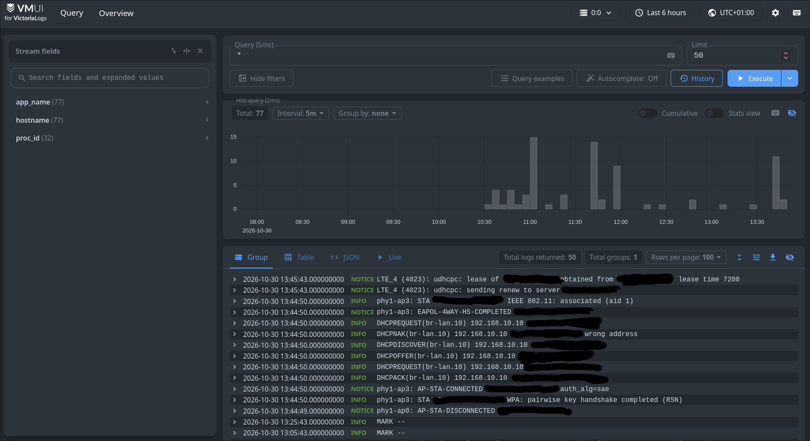

# Raspberry pi Monitoring

## 1. Goal

I chose a raspberry pi 4 because my router does not have enough resources to run these additional service.

My goals was to collect logs, views them through a web interface, and detect and block malicious IP addresses in one place.

I used syslog-ng to collect logs and deployed VictoriaLogs and CrowdSec in docker container.

## 2. Hardware & Network

I used a **Raspberry Pi 4 with 1 GB RAM**, pendrive 64GB and installed **Raspberry Pi OS Lite 64-bit**. I also used a case with a cooling fan and copper heatsinks.


### Network Configuration

I created a separate **VLAN 50** for the Raspberry Pi. At first, I did not plan to create another VLAN, but I decided it would make the configuration easier and provide better network isolation.

The Raspberry Pi is connected to the router's physical **WAN port**, which I reconfigured as a LAN port because I do not use it for the internet connection.

I also created a DHCP reservation to keep the same IP address.

- **VLAN:** 50 — RASPBERRY
- **Raspberry Pi IP:** `192.168.50.106`

### Firewall

I configured firewall rules to secure the Raspberry Pi network:

- Allowed SSH access to the Raspberry Pi only from the **MANAGEMENT VLAN**.
- Allowed DNS and DHCP traffic.
- Configured forwarding from the **RASPBERRY VLAN** to `wwan0` to allow system updates and package downloads.


## 3. Syslog-ng

I installed syslog-ng directly on the Raspberry Pi using the `syslog-ng-core` package without Docker.

I configured syslog-ng to receive logs from the Cudy router over **UDP port 514** and save them to a local file.

- Syslog server: `192.168.50.106:514`
- Protocol: UDP
- Log file: /var/log/openwrt/cudy.log
- Configuration: /etc/syslog-ng/conf.d/openwrt.conf

[View syslog-ng configuration](./syslog-ng_and_logrotate/openwrt.conf)

On OpenWRT, I enabled remote logging and set the Raspberry Pi as the destination server.

**Testing**
To test the connection, I generated a log message on the Cudy router using the `logger` command:
```bash
logger -t TEST-RASPBERRY "Test log forwarding"
```

I checked the log file on the Raspberry Pi:
```bash
sudo tail -f /var/log/openwrt/cudy.log
```

The test was successful, and logs from OpenWRT started appearing on the Raspberry Pi.

## 4. Logrotate

I decided to use `logrotate` to prevent log files from filling up the storage. Currently, I use a 64GB pendrive, but I plan to upgrade to at least 128GB in the future.

I configured logrotate with the following settings:
- Daily rotation - checks logs every day.
- Maximum file size: 10MB - rotates logs earlier if they exceed this size.
- Compression - compression old log files to save disk space.
- Skip empty files - avoids rotating empty logs.
- File permissions: `0640` - restricts access to log files

I also configured `syslog-ng-ctl reopen` to reopen the log file after rotation without restarting syslog-ng.

**Testing**

First, I tested the configuration in debug mode:
```bash
sudo logrotate -d /etc/logrotate.d/logrotate.conf
```

Then I forced a real rotation to check if everythink worked:
```bash
sudo logrotate -v -f /etc/logrotate.d/logrotate.conf
```

[View logrotate configuration](./syslog-ng_and_logrotate/logrotate.conf)

## 5. VictoriaLogs

## 5. Docker & VictoriaLogs

### 5.1 Docker Installation

I installed Docker Engine and Docker Compose on my Raspberry Pi using the [official Docker documentation](https://docs.docker.com/engine/install/debian/).

After installation, I tested Docker using the `hello-world` container.

### 5.2 VictoriaLogs Deployment

I deployed **VictoriaLogs** using Docker Compose to store, search and analyze logs from my OpenWrt router.

I configured the container with the following settings:

- **Memory limit:** 384 MiB
- **Retention period:** 7 days
- **Storage limit:** 2 GiB
- **Docker named volume:** persistent log storage
- **TCP port 29514:** receiving logs from syslog-ng
- **Port 9428:** Web UI

I used a Docker named volume to keep VictoriaLogs data even when the container is recreated.

During deployment, I had a problem with Docker memory limits because the `memory` controller was disabled in cgroups v2.

I enabled it by adding `cgroup_enable=memory` to `/boot/firmware/cmdline.txt` and rebooting the Raspberry Pi.

After recreating the container, the 384 MiB memory limit worked correctly.

**Configuration file:** [compose.yaml](./VictoriaLogs/compose.yaml)

### 5.3 Syslog-ng Integration

I configured syslog-ng to forward logs to VictoriaLogs using TCP port `29514`.

The logs are sent to VictoriaLogs while syslog-ng also saves them locally in:

`/var/log/openwrt/cudy.log`

This allows me to keep local log files and search them through the VictoriaLogs Web UI.

### 5.4 SSH Port Forwarding

I used **SSH Local Port Forwarding** to securely access the VictoriaLogs Web UI from my laptop.

The VictoriaLogs Web UI is only available on `127.0.0.1:9428` on the Raspberry Pi.

I created an SSH tunnel using:

```bash
ssh -N -i ~/.ssh/raspberry \
  -L 127.0.0.1:9428:127.0.0.1:9428 \
  piadmin@192.168.50.106
```

After establishing the tunnel, I can open VictoriaLogs in my browser:

`http://localhost:9428/select/vmui/`

This allows me to access the Web UI through an encrypted SSH connection without exposing port `9428` to other VLANs.

### 5.5 Testing

I tested the integration by generating log messages on the OpenWrt router using the `logger` command.

I confirmed that the logs were successfully received by syslog-ng and appeared in VictoriaLogs.

I also tested LogsQL queries to filter events from services such as **Dropbear, Tailscale, Unbound and hostapd**.



## 6. CrowdSec

### 6.1 Goal

I decided to use **CrowdSec** to analyze OpenWrt logs and detect suspicious activity, such as SSH brute-force attacks.

CrowdSec runs in a Docker container on my Raspberry Pi and uses logs collected by syslog-ng.

### 6.2 Docker Configuration

I deployed CrowdSec using Docker Compose in a separate directory: `/opt/crowdsec/`.

Main settings:

- **Docker image:** `crowdsecurity/crowdsec:v1.8.2`
- **Memory limit:** 320 MiB
- **Collection:** `crowdsecurity/linux`
- **Parser:** `crowdsecurity/dropbear-logs`
- **Named volumes:** persistent configuration and data
- **Bind mount:** read-only access to OpenWrt logs

The bind mount allows CrowdSec to read log files from the Raspberry Pi without modifying them.

### 6.3 Log Acquisition

I created an `acquis.d/openwrt.yaml` file to configure the log source:

```yaml
source: file

filenames:
  - /logs/openwrt/cudy.log

labels:
  type: syslog
```

CrowdSec reads logs from `/var/log/openwrt/cudy.log` on the Raspberry Pi, mounted inside the container as `/logs/openwrt/cudy.log`.

### 6.4 Detection & Testing

I configured the Dropbear parser and SSH brute-force detection scenarios.

I tested the configuration using `cscli explain` with a sample log message containing a login attempt for a nonexistent user.

The test confirmed that CrowdSec correctly parsed the Syslog message, recognized the Dropbear event and matched it to SSH detection scenarios.

I also checked the acquisition metrics to confirm that CrowdSec successfully read and parsed the test log.

### 6.5 Monitoring

I use the `cscli` tool to monitor CrowdSec locally.

Useful commands:

```bash
# List alerts
sudo docker exec crowdsec cscli alerts list

# List active decisions
sudo docker exec crowdsec cscli decisions list

# Show log acquisition metrics
sudo docker exec crowdsec cscli metrics show acquisition

# Show scenario metrics
sudo docker exec crowdsec cscli metrics show scenarios
```

### 6.6 Current Configuration

CrowdSec currently analyzes logs and can generate alerts when detection scenarios are triggered.

I have not configured a bouncer yet, so CrowdSec does not automatically block IP addresses on my OpenWrt router.

I use the local CLI to manage and monitor CrowdSec instead of installing an additional web interface.
