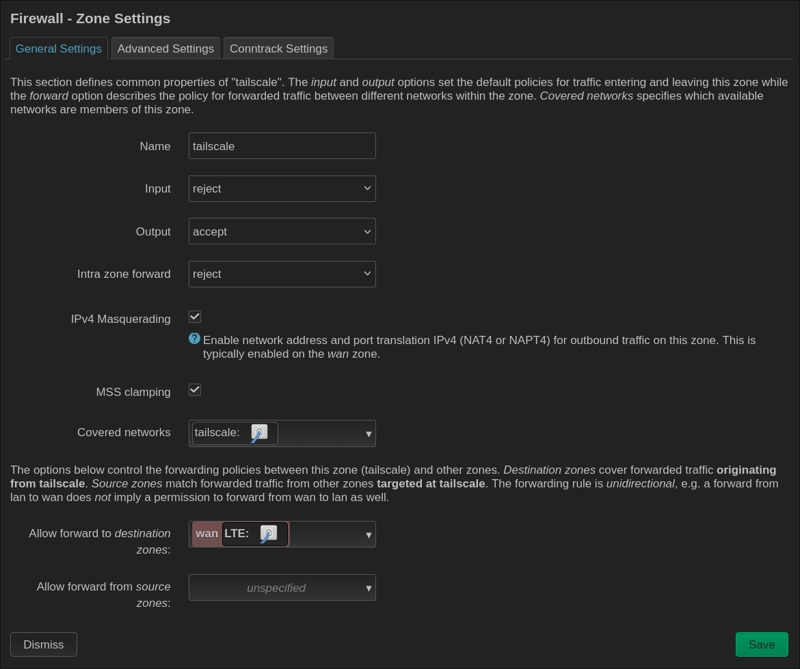
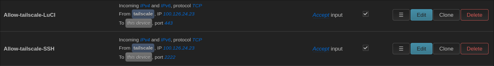

# Tailscale

## Goal

Tailscale is used for secure remote access to my OpenWrt router and for optional Internet access through the router as an Exit Node.

In this project, Tailscale has two separate purposes:

1. remote router management:
   - LuCI over HTTPS,
   - SSH,

2. optional Internet access:
   - OpenWrt works as a Tailscale Exit Node,
   - laptop traffic can be routed through the router LTE connection.

---

## Why I changed from WireGuard to Tailscale

At first, I planned to use a normal WireGuard server.

However, my router uses an LTE connection and is behind CGNAT.

Because of this, the router does not have a directly reachable public IPv4 address.

Running a normal WireGuard server from the Internet would therefore require additional infrastructure or another server.

Because of this, I changed to Tailscale.

Tailscale uses WireGuard for encrypted connections, but it also automatically handles connections through NAT and CGNAT.

With Tailscale I do not need:

- a public IPv4 address,
- WAN port forwarding,
- direct Internet exposure of LuCI,
- direct Internet exposure of SSH.

---

## Architecture

```text
Remote laptop
     |
     v
  Internet
     |
     v
 Tailscale
     |
     v
OpenWrt LTE Router
   |
   +--> HTTPS 443 --> LuCI
   |
   +--> SSH 2222 --> Dropbear
   |
   +--> Exit Node --> LTE --> Internet
```

Remote management and Exit Node access are treated as separate functions.

---

## Installation and Tailnet Connection

After installing Tailscale, the router was connected to my tailnet.

Basic command:

```bash
tailscale up
```

Connection status:

```bash
tailscale status
```

Router Tailscale IPv4 address:

```bash
tailscale ip -4
```

The router receives a private address from the range:

```text
100.x.x.x/32
```

---

## Tailscale Interface

OpenWrt uses::

```text
tailscale0
```

A logical OpenWrt interface and a separate firewall zone were created for it.


---

## Tailscale Firewall Zone

Final firewall policy:

```text
Input: REJECT
Output: ACCEPT
Forward: REJECT
Masquerading: enabled
MSS Clamping: enabled
```

Incoming traffic is blocked by default and only selected services are allowed with specific firewall rules.




---

## `Prevent NAT leakage` Problem

During testing, I had the following problem:

```text
tailscale ping        -> worked
tailscale ping --tsmp -> worked
normal ping           -> failed
TCP 443               -> timeout
```

The `nftables` rules showed that some traffic leaving through `tailscale0` was marked by conntrack as:

```text
ct state invalid
```

and was dropped by the OpenWrt rule:

```text
Prevent NAT leakage
```

The problem was fixed by enabling:

```bash
uci set firewall.@zone[6].masq_allow_invalid='1'
uci commit firewall
service firewall restart
```

After this change, normal IP traffic through Tailscale started working correctly.

---

## Remote LuCI Access

LuCI is available through the router Tailscale address:

```text
https://100.x.x.x
```

Port:

```text
TCP 443
```

The Tailscale firewall zone uses:

```text
Input: REJECT
```

A separate firewall rule allows LuCI access only from the Tailscale IP address of my laptop.

```text
Laptop Tailscale IP
        |
        | TCP 443
        v
OpenWrt Tailscale IP
        |
        v
      LuCI
```

LuCI uses a local self-signed certificate, so the browser may show a certificate warning.

---

## Remote SSH Access

SSH on OpenWrt uses a custom port:

```text
TCP 2222
```

At first, Dropbear was bound only to the MANAGEMENT interface.

This caused:

```text
Connection refused
```

when connecting through the Tailscale IP address.

Dropbear was changed to listen on all IPv4 addresses:

```text
0.0.0.0:2222
```

Access is then controlled by the firewall.

SSH is allowed only from:

- my management laptop IP,
- my laptop Tailscale IP.

The WAN zone does not allow SSH access.

Password authentication is disabled:

```text
PasswordAuthentication no
```

SSH key authentication is used instead.

---

## DNS and Tailscale

After enabling Tailscale, the router started using:

```text
100.100.100.100
```

as its DNS resolver.

This was not compatible with my local DNS architecture:

```text
Client
  |
  v
AdGuard Home :53
  |
  v
Unbound :5335
```

This caused problems with local DNS and package downloads.

Tailscale DNS was disabled:

```bash
tailscale set --accept-dns=false
```

After this change, the router started using the local resolver again:

```text
127.0.0.1
```

---

## Exit Node

OpenWrt is also configured as a Tailscale Exit Node.

On the router:

```bash
tailscale set --advertise-exit-node
```

The Exit Node option was then approved in the Tailscale admin panel.

For Internet access, forwarding was allowed from:

```text
tailscale -> wan
```

Architecture:

```text
Laptop
  |
  v
Tailscale
  |
  v
OpenWrt
  |
  v
LTE / WAN
  |
  v
Internet
```

Using the Exit Node is optional.

If it is not selected on the laptop, Tailscale is only used for communication between devices.

---

## Enabling the Exit Node on the Laptop

The Exit Node can be selected from the Tailscale application or from the terminal.

Example:

```bash
tailscale set --exit-node=<ROUTER-TAILSCALE-IP>
```

The current configuration can be checked with:

```bash
tailscale debug prefs | grep -E 'ExitNodeID|ExitNodeIP'
```

When the Exit Node is enabled, `ExitNodeID` is not empty.

---

## Exit Node Verification

To check the public IPv4 address on the laptop:

```bash
curl -4 https://ifconfig.me
```

The same command can be used on OpenWrt:

```bash
curl -4 https://ifconfig.me
```

If both devices show the same public IPv4 address, laptop Internet traffic is leaving through the router LTE connection.

---

## Tailscale Tests

### Check Tailscale status

```bash
tailscale status
```

### Test Tailscale daemon connectivity

```bash
tailscale ping <TAILSCALE-IP>
```

### Test TSMP

```bash
tailscale ping --tsmp <TAILSCALE-IP>
```

### Normal IP test

```bash
ping <TAILSCALE-IP>
```

### LuCI test

```bash
curl -vk https://<TAILSCALE-IP>/
```

### SSH test

```bash
ssh -p 2222 root@<TAILSCALE-IP>
```

---

## Security

Security measures:

- no WAN port forwarding,
- LuCI is not directly exposed to the Internet,
- SSH is not directly exposed to the Internet,
- separate Tailscale firewall zone,
- `Input: REJECT`,
- `Forward: REJECT`,
- LuCI access only from one Tailscale IP,
- SSH access only from one Tailscale IP,
- SSH key authentication only,
- password authentication disabled,
- custom SSH port,
- WAN cannot access management services.

---

## Result

Tailscale allows me to securely manage my OpenWrt router from any network with Internet access.

I can:

- open LuCI,
- connect through SSH,
- use the router as an Exit Node,
- route my Internet traffic through the router LTE connection.

This works without a public IPv4 address and without opening management ports on the WAN interface.
